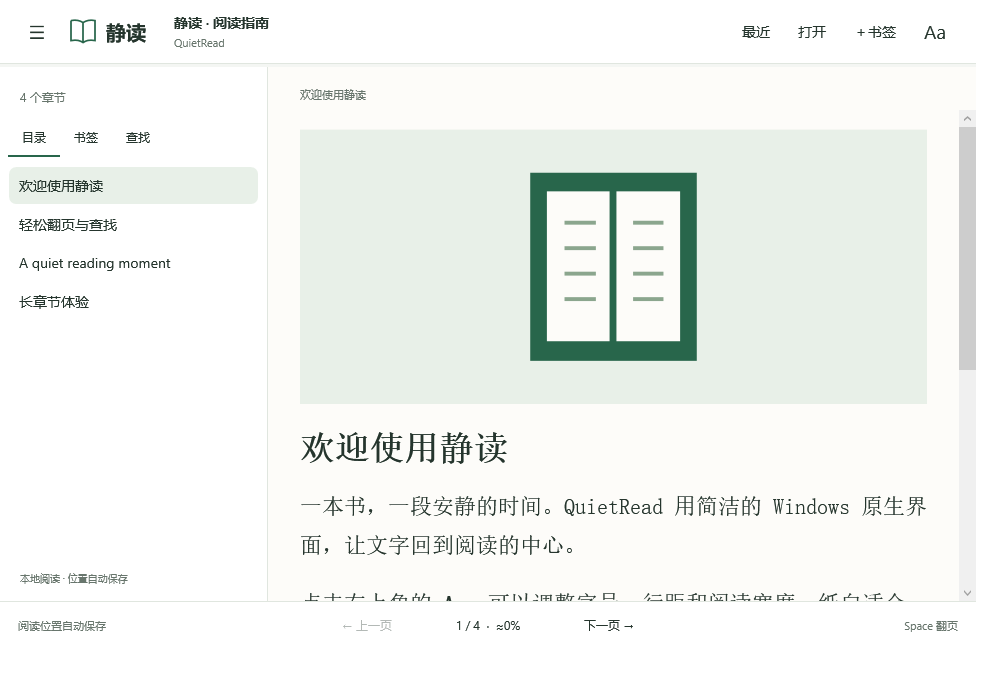

# QuietRead · 静读

面向 **Windows 11 x64** 的本地 EPUB 阅读器，使用原生 WPF 界面，提供续读、书签、高亮笔记与长期书库。

本地离线 · 解压即用 · 无账号 · 无广告 · 无遥测

[](https://github.com/lhy8888/epub/actions/workflows/ci.yml)
[](https://github.com/lhy8888/epub/actions/workflows/security.yml)



## 下载与开始阅读

1. 打开 [构建下载页面](https://github.com/lhy8888/epub/actions/workflows/ci.yml)，选择 `main` 最近一次成功运行，在 **Artifacts** 下载 `QuietRead-Windows-x64`。
2. 解开下载包，再将其中的 `QuietRead-*-Windows-x64.zip` **完整解压**，双击 `QuietRead.exe`。便携包包含运行时，无需另装 .NET。
3. 点击「打开」或将一个本地 `.epub` 文件拖入窗口。包内的 `samples/QuietRead-Guide.epub` 可用于体验。
4. 使用滚轮或底部「上一页 / 下一页」阅读，在侧栏切换目录、书签、查找和批注；「Aa」调整外观，「全屏」扩大阅读区域。

再次启动程序或通过命令行打开 EPUB，会将打开请求转交到现有窗口。

Actions 下载需要登录 GitHub，构建产物有保留期限。当前提供未签名的 Windows x64 便携包；正式版本发布后可从 [Releases](https://github.com/lhy8888/epub/releases) 下载。

## 当前功能

| 功能 | 支持内容 |
| --- | --- |
| EPUB 阅读 | 可重排 EPUB 2/3，中英文、标题、粗体/斜体、引用、代码及基础图片显示 |
| 目录导航 | 嵌套目录展开/折叠、标题筛选、当前锚点标记及书内链接跳转 |
| 续读与书签 | 按文字位置保存；调整字号、正文宽度或窗口后恢复位置；兼容旧阅读记录 |
| 前进与返回 | 目录、链接、书签和搜索跳转的前进/后退；返回搜索前位置 |
| 脚注 | 识别带 EPUB/ARIA 注释标记的本地脚注，预览文字并跳转原文 |
| 搜索 | 当前章或全书、区分大小写、整词匹配、进度与停止、结果高亮及前后结果切换；支持中英文交界匹配 |
| 阅读外观 | 纸白/暖色/夜间主题，系统字体、字号、行距、宽度、段距、首行缩进与对齐；小说/文档预设、单书覆盖与恢复默认 |
| 高亮与笔记 | 黄色/绿色/蓝色/粉色高亮；新增、编辑、定位和删除笔记；单书 Markdown 摘录导出 |
| 长期书库 | 编辑本地书名、作者、标签、系列及未读/在读/已读状态；筛选、按最近阅读/书名/作者排序 |
| 文件关联 | 字节内容相同的 EPUB 改名或移动后恢复阅读数据；从书库重新关联本地文件 |
| 备份与导入 | 全库或单书 JSON 导出；导入预检、冲突选择及书签/批注合并 |
| 保存与无障碍 | 自动保存、保存状态、失败重试和关闭前刷新；正文/脚注 UI Automation 文本接口、系统高对比、可见焦点及状态播报 |

## 常用操作

- **添加高亮和笔记**：在正文选中文字，进入「批注」，选择颜色并点击「选区高亮」；选中批注后编辑笔记，点击「保存笔记」。
- **为一本书设置外观**：点击「Aa」，勾选「本书独立外观」。取消勾选或点击「本书恢复默认」后继承全局设置。
- **管理书籍**：点击「书库」，选择条目后编辑元数据、调整阅读状态、导出数据或重新关联文件。元数据修改保存在本地，原 EPUB 保持只读。
- **处理保存失败**：查看底部保存状态并点击「重试保存」。关闭时若刷新失败，程序会提示保留窗口或放弃未保存修改。

详细行为及限制见 [阅读导航说明](docs/P0-IMPLEMENTATION.md) 和 [书库、批注与备份说明](docs/P1-IMPLEMENTATION.md)。

## 阅读数据与迁移

阅读数据默认保存在 `%LOCALAPPDATA%\QuietRead`，与程序的解压目录分开：最近记录和全局设置位于 `state.json`，长期书库位于 `library.json`，逐书位置、书签、批注及独立外观位于 `books/`。

在「书库」导出全部或单书 JSON，可备份和恢复阅读数据。导入前会显示新增、已有及冲突数量，由用户选择保留现有值或采用导入值。**JSON 备份不包含 EPUB 文件，也不导出原设备的文件路径**；迁移时另行复制 EPUB，并在新设备重新关联。Markdown 用于阅读和分享摘录，恢复数据请使用 JSON。

主页「清除阅读记录」只清除最近列表，长期书库、续读、书签和批注仍保留。「移除书库条目」会删除该书的阅读数据，原 EPUB 文件保留；移除前可先导出需要的批注。

| 数据边界 | 当前上限 |
| --- | ---: |
| 长期书库 / 最近列表 | 1,000 本 / 32 本 |
| 每本书的书签 / 批注 | 64 个 / 128 条 |
| 单条批注摘录 / 笔记 | 4,096 字符 / 2,000 字符 |
| 单书阅读数据 | 8 MiB |
| JSON 备份或导入 | 16 MiB；全库超额时按单书导出 |

旧数据可读取并迁移。升级前建议备份；超过旧版 2 MiB 上限的单书数据无法由旧版读取，请避免旧版覆盖同一数据目录。

## 兼容范围

适合小说及一般文字书。图片支持 JPEG、PNG、GIF 首帧和 BMP；原书采用简化排版，仅接受少量有界段落属性，使用系统字体。

暂不支持完整原书 CSS、嵌入字体、复杂 SVG、音视频、DRM 和固定版式，也未提供 PDF/MOBI 阅读、格式转换、云同步或跨软件批注格式互通。

文字定位主要针对内容未改变的 EPUB。内容有变化或校验失配时，续读可使用比例回退，无法可靠验证的高亮会跳过；同名但内容不同的书籍不会自动合并。未标注或结构复杂的脚注可能直接跳转原文。当前阅读采用滚动视图，「翻页」按钮按屏幕、正文分段或章节前后移动。

## 安全、隐私与性能

程序以普通用户权限运行，阅读数据保存在本机，没有遥测或书籍上传。书内脚本、表单和外部网页链接不会成为可执行内容；不自动加载远程图片、字体或网页，不修改原 EPUB。

读取时检查 ZIP 路径、目录与 CRC、XML 结构及图片签名/尺寸，并限制文件大小、解压量、解析复杂度和数据集合。导入 JSON 在构造对象前检查数量、长度及重复属性。安全设计及具体预算见 [架构说明](docs/ARCHITECTURE.md) 和 [安全审查](docs/SECURITY-REVIEW.md)。

章节按需解析，最多缓存两章并受 8 MiB 模型估算预算约束；长章节分段显示，搜索逐章扫描并复用缓冲区。解析、图片解码、搜索和批注选区处理在后台执行，可取消；外观调整复用正文。失配定位使用有界窗口及共享扫描预算，避免反复复制长段落。这些预算不代表整个进程的工作集上限。

## 从源码构建

使用 [global.json](global.json) 指定的 **.NET SDK 10.0.401**（允许同一功能带补丁更新）。Python 3.11+ 用于仓库检查、示例和打包，无需 Node.js 或第三方 NuGet 包。Linux 可执行核心测试及交叉编译；运行 WPF 和打包验证请使用 Windows。

```powershell
git clone https://github.com/lhy8888/epub.git
cd epub
dotnet restore QuietRead.sln --locked-mode
dotnet build QuietRead.sln -c Release --no-restore
dotnet run --project src/QuietRead.App -c Release --no-restore
```

Windows 上生成包含运行时的便携包：

```powershell
.\tools\Build.ps1
```

输出为 `artifacts/QuietRead-*-Windows-x64.zip` 及对应 `.sha256` 校验文件。

## 测试与验证

当前回归包含 **95 项核心/安全测试和 40 项 Windows WPF 实窗测试**。GitHub Actions 在 Linux/Windows 执行核心测试，并在 Windows 验证界面、持久化、便携 ZIP 和实际 EXE 双启动；另有源码策略、格式、依赖审计及 C#/Actions CodeQL 检查。

```powershell
# Linux / Windows：核心、安全、示例兼容性及基准
dotnet run --project tests/QuietRead.Tests -c Release --no-restore -- --benchmark --validate samples/QuietRead-Guide.epub --report artifacts/core-tests.json

# Windows：真实 WPF 窗口测试及截图
dotnet run --project tests/QuietRead.UiTests -c Release --no-restore -- samples/QuietRead-Guide.epub artifacts/ui-tests.json artifacts/windows-smoke.png

python tools/check_repository.py
dotnet format whitespace QuietRead.sln --no-restore --verify-no-changes
python tools/check_dependencies.py --report artifacts/dependencies.json
```

两个测试项目是控制台回归程序，请通过 `dotnet run` 执行。最新通过状态、测试报告与截图以 [对应提交的 Actions 运行](https://github.com/lhy8888/epub/actions) 为准；本轮安全、性能、保存及异步路径修复见 [复审修复记录](docs/REAUDIT-FIXES.md)。

Windows 11 真机的 Narrator/NVDA、多 DPI、实际高对比切换、睡眠恢复和长期滚动/工作集表现仍需人工验收。

## 参与开发

[开发指南](CONTRIBUTING.md) · [架构说明](docs/ARCHITECTURE.md) · [安全政策](SECURITY.md) · [版本记录](CHANGELOG.md) · [反馈问题](https://github.com/lhy8888/epub/issues/new/choose)

源码采用 [MIT](LICENSE) 许可证。
